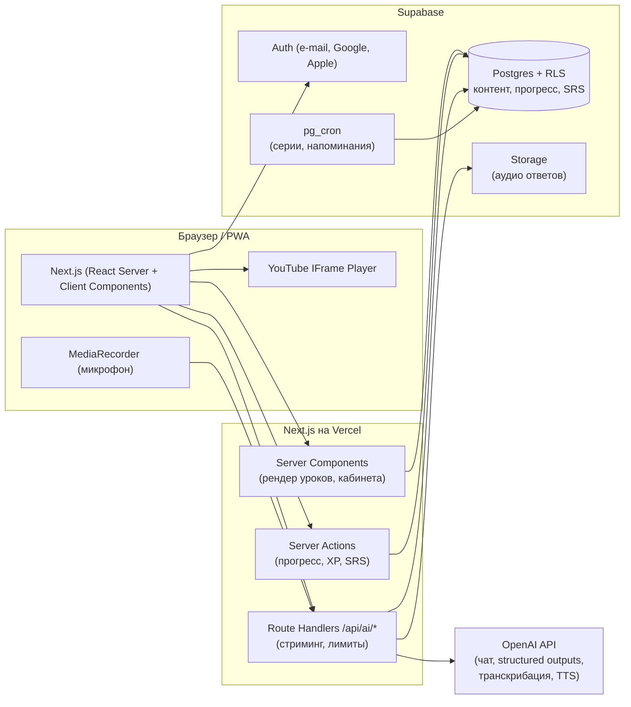

# English Path: техническое и методическое задание

Интерактивная платформа для **самостоятельного** изучения английского с нуля (A0) до свободного владения (C2). Ученик идёт по программе шаг за шагом. Роль преподавателя делят между собой структура курса, автопроверка, интервальное повторение и ИИ-тьютор.

| Документ | Что внутри |
|---|---|
| **SPEC.md** (этот файл) | Архитектура, план MVP, шаблон урока, методики, упражнения, quiz, ИИ, прототип, чек-лист |
| [COURSE_STRUCTURE.md](COURSE_STRUCTURE.md) | Полная программа A0–C2: 7 уровней → 56 units → 341 урок |
| [../index.html](../index.html) | Кликабельный прототип: личный кабинет, урок из 7 шагов, словарь с SRS, входной тест, ИИ-панель |

## Содержание

0. [Продукт и принципы](#0-продукт-и-принципы)
1. [Архитектура](#1-архитектура)
2. [План MVP](#2-план-mvp)
3. [Структура курса A0–C2](#3-структура-курса-a0c2)
4. [Шаблон урока](#4-шаблон-урока)
5. [10 методик и их внедрение](#5-10-методик-и-их-внедрение)
6. [Примеры упражнений](#6-примеры-упражнений)
7. [Quiz](#7-quiz)
8. [Роль ИИ](#8-роль-ии)
9. [Прототип главной и страницы урока](#9-прототип-главной-и-страницы-урока)
10. [Чек-лист запуска](#10-чек-лист-запуска)
11. [Ответы к упражнениям и quiz](#11-ответы-к-упражнениям-и-quiz)

---

## 0. Продукт и принципы

**Целевая аудитория** (интерфейс и объяснения на русском, язык объяснений — настройка профиля на будущее):

| Сегмент | Кто это | Что важно для продукта |
|---|---|---|
| **Все пользователи** | Любой, кто хочет выучить английский: без отбора по профессии и цели | Понятный вход без подготовки, бесплатный первый урок, объяснения без лингвистических терминов |
| **С нуля и до Advanced** | От «не знаю алфавит» (A0) до продолжающих B1–C1, которые хотят C1/C2 | Входной тест, старт с любого уровня, сквозная программа A0–C2 без «потолка» |
| **Взрослые 16+, учатся сами** | Нет преподавателя, учатся 15–30 минут в день, часто с телефона | Никаких тупиков (ИИ-тьютор, объяснение каждой ошибки), микрошаги, мотивация без давления, взрослые темы и ситуации |
**Обещание продукта:** «Понятный путь от первой фразы до C2: каждый день вы знаете, что делать дальше, и видите прогресс».

### Пять принципов самостоятельного обучения

1. **Никаких тупиков.** У ученика нет учителя, которого можно спросить. Поэтому у каждого правила есть пример, у каждой ошибки есть объяснение, а на каждый вопрос отвечает ИИ-тьютор.
2. **Следующий шаг всегда очевиден.** Кнопка «Продолжить» в кабинете ведёт ровно туда, где ученик остановился, вплоть до шага внутри урока.
3. **Сначала смысл, потом форма.** Каждый unit решает реальную коммуникативную задачу. Грамматика нужна для неё, а не сама по себе.
4. **Вспоминать, а не перечитывать.** Прогресс измеряется тем, что ученик может сделать без подсказки: Quiz, SRS, speaking и writing.
5. **Мотивация без манипуляций.** Серии дней, XP и цели поддерживают привычку, но не наказывают за пропуск и не продают «спасение» серии.

**Главная метрика (North Star):** число учеников за неделю, которые прошли ≥ 3 урока **или** сделали ≥ 50 повторений SRS.

---

## 1. Архитектура

### 1.1 Схема



### 1.2 Стек и почему

| Слой | Технология | Зачем |
|---|---|---|
| Фронтенд и бэкенд | **Next.js (App Router), TypeScript** | Server Components отдают урок готовым HTML, это быстро и хорошо для SEO лендинга. Server Actions подходят для записи прогресса без отдельного API. |
| UI | Tailwind CSS + shadcn/ui, Framer Motion для микровзаимодействий | Быстрая сборка доступного интерфейса (a11y из коробки) |
| БД, авторизация, файлы | **Supabase** (Postgres, Auth, Storage, RLS, pg_cron) | Безопасность на уровне строк: ученик физически не может прочитать чужой прогресс |
| ИИ | **OpenAI API** через собственный слой `lib/ai` | Чат-тьютор (стриминг), проверка текстов (structured outputs → JSON), транскрибация речи, TTS для аудио словаря |
| Повторение | **FSRS** (библиотека `ts-fsrs`), SM-2 как запасной вариант | FSRS точнее SM-2 предсказывает забывание, а значит, меньше лишних повторений при той же запоминаемости |
| Видео | **YouTube IFrame Player API**, домен `youtube-nocookie.com` | Бесплатный хостинг, субтитры, отслеживание просмотра для зачёта шага |
| Валидация контента | zod | Урок с ошибкой в структуре не попадёт в базу |
| Аналитика | PostHog (события, воронки, A/B) | Воронка урока по шагам, удержание |
| Ошибки | Sentry | |
| Тесты | Vitest (логика SRS, адаптивности), Playwright (сквозной сценарий «урок → quiz → SRS») | |

> **Риски для русскоязычной аудитории (проверить до старта):**
> - **YouTube** в РФ работает с перебоями (замедление с 2024 года). Нужен резервный видеохостинг (Kinescope, VK Video, Cloudflare Stream), а поле `video` в уроке должно поддерживать несколько провайдеров (§4.2).
> - **OpenAI API** доступен не во всех странах. Проверьте условия провайдера для стран вашей аудитории. Весь доступ к ИИ должен идти через `lib/ai/provider.ts`, чтобы провайдера можно было сменить без переписывания продукта.
> - **152-ФЗ.** Если в базе хранятся персональные данные граждан РФ, могут потребоваться локализация хранения и согласие на обработку. Нужна консультация юриста. Возможный вариант: self-hosted Supabase в российском дата-центре.

### 1.3 Модель данных (Supabase, Postgres)

```sql
-- ===== Контент (читают все, пишет только админ/сид) =====
create table levels (
  id text primary key,                -- 'a0' … 'c2'
  code text not null,                 -- 'A0'
  name text not null,                 -- 'Starter'
  goals text[] not null,              -- дескрипторы «I can…» (шаг 3 урока)
  intro jsonb not null,               -- видео-введение к уровню {provider, id, title}
  position int not null
);

create table modules (
  id text primary key,                -- 'a1-3'
  level_id text not null references levels on delete cascade,
  title text not null,
  situation text not null,            -- коммуникативная ситуация unit
  position int not null
);

create table lessons (
  id text primary key,                -- 'a1-3-2'
  module_id text not null references modules on delete cascade,
  position int not null,
  title text not null,
  goal text not null,
  skill_tags text[] not null default '{}',   -- 'grammar.present_simple.3sg', 'func.directions'
  content jsonb not null,             -- 7 блоков урока, схема в §4.2 (валидируется zod при сиде)
  version int not null default 1,
  published boolean not null default false
);

create table vocab (
  id bigserial primary key,
  lesson_id text not null references lessons on delete cascade,
  term text not null,
  ipa text not null,                  -- транскрипция
  translation text not null,
  example text,
  audio_url text,                     -- сгенерировано TTS и сохранено в Storage
  cefr text
);

-- ===== Пользователь =====
create table profiles (
  id uuid primary key references auth.users on delete cascade,
  display_name text,
  role text not null default 'student' check (role in ('student','teacher','admin')),
  current_level text references levels default 'a0',
  unlock_from text references lessons,       -- результат входного теста
  daily_goal_xp int not null default 50,     -- 20 / 50 / 100
  timezone text not null default 'Europe/Moscow',
  xp_total int not null default 0,
  created_at timestamptz not null default now()
);

create table lesson_progress (
  user_id uuid references auth.users on delete cascade,
  lesson_id text references lessons on delete cascade,
  steps_done text[] not null default '{}',  -- ключи пройденных шагов: theory, video, level, words, practice, quiz, output
  xp_earned int not null default 0,          -- XP за этот урок (прогресс-бар урока)
  status text not null default 'started' check (status in ('started','passed')),
  best_score smallint,
  attempts int not null default 0,
  passed_at timestamptz,
  primary key (user_id, lesson_id)
);

create table attempts (                       -- каждый ответ: основа адаптивности и аналитики
  id bigserial primary key,
  user_id uuid not null references auth.users on delete cascade,
  lesson_id text references lessons,
  kind text not null check (kind in ('practice','quiz','placement','remedial')),
  item_id text not null,
  skill_tag text,
  correct boolean not null,
  response jsonb,
  ms_spent int,
  created_at timestamptz not null default now()
);

create table skill_mastery (                  -- модель знаний ученика по тегам
  user_id uuid references auth.users on delete cascade,
  tag text not null,
  mastery real not null default 0,            -- 0..1
  evidence int not null default 0,
  updated_at timestamptz not null default now(),
  primary key (user_id, tag)
);

-- ===== SRS (поля совпадают с моделью Card из ts-fsrs) =====
create table srs_cards (
  id bigserial primary key,
  user_id uuid not null references auth.users on delete cascade,
  kind text not null default 'word' check (kind in ('word','rule')),
  vocab_id bigint references vocab on delete set null,   -- null = своё слово или правило
  lesson_id text references lessons,                     -- для карточек-правил
  term text not null,                 -- слово или лицевая сторона правила (задание)
  translation text not null,          -- перевод или ответ
  rule_note text,                     -- объяснение правила на обороте
  due timestamptz not null default now(),
  stability real not null default 0,
  difficulty real not null default 0,
  elapsed_days int not null default 0,
  scheduled_days int not null default 0,
  reps int not null default 0,
  lapses int not null default 0,
  state smallint not null default 0,          -- 0 New, 1 Learning, 2 Review, 3 Relearning
  last_review timestamptz,
  unique (user_id, kind, term)
);
create index on srs_cards (user_id, due);

create table srs_reviews (
  id bigserial primary key,
  card_id bigint not null references srs_cards on delete cascade,
  user_id uuid not null references auth.users on delete cascade,
  rating smallint not null,                   -- 1 Again, 2 Hard, 3 Good, 4 Easy
  reviewed_at timestamptz not null default now(),
  elapsed_days int, scheduled_days int        -- для будущей оптимизации параметров FSRS
);

-- ===== Геймификация =====
create table xp_events (
  id bigserial primary key,
  user_id uuid not null references auth.users on delete cascade,
  amount int not null,
  reason text not null,                       -- 'lesson_passed', 'quiz_perfect', 'srs_review', …
  ref text,
  created_at timestamptz not null default now()
);
create table streaks (
  user_id uuid primary key references auth.users on delete cascade,
  current int not null default 0,
  longest int not null default 0,
  last_active_date date,
  freezes smallint not null default 0         -- «заморозка» серии, зарабатывается, не покупается
);
create table achievements (id text primary key, title text, icon text, rule jsonb);
create table user_achievements (
  user_id uuid references auth.users on delete cascade,
  achievement_id text references achievements,
  earned_at timestamptz not null default now(),
  primary key (user_id, achievement_id)
);

-- ===== Продуктивные навыки и ИИ =====
create table submissions (
  id bigserial primary key,
  user_id uuid not null references auth.users on delete cascade,
  lesson_id text references lessons,
  kind text not null check (kind in ('writing','speaking')),
  text text,                                  -- текст или транскрипт
  audio_path text,                            -- Storage: speaking/{user_id}/{id}.webm
  review_by text not null check (review_by in ('ai','teacher')),
  status text not null check (status in ('ai_checked','pending','in_review','reviewed')),
  ai_feedback jsonb,                          -- схема в §8.4
  teacher_id uuid references auth.users,      -- кто взял работу из очереди
  teacher_score smallint check (teacher_score between 1 and 5),
  teacher_comment text,
  reviewed_at timestamptz,
  created_at timestamptz not null default now()
);
create table ai_usage (                        -- лимиты и стоимость
  id bigserial primary key,
  user_id uuid not null references auth.users on delete cascade,
  feature text not null,                      -- 'tutor' | 'check' | 'speech'
  tokens_in int, tokens_out int, audio_seconds int,
  created_at timestamptz not null default now()
);

-- ===== RLS =====
alter table profiles        enable row level security;
alter table lesson_progress enable row level security;
alter table attempts        enable row level security;
alter table skill_mastery   enable row level security;
alter table srs_cards       enable row level security;
alter table srs_reviews     enable row level security;
alter table xp_events       enable row level security;
alter table streaks         enable row level security;
alter table user_achievements enable row level security;
alter table submissions     enable row level security;
alter table ai_usage        enable row level security;

-- шаблон «только свои строки» (повторить для каждой пользовательской таблицы)
create policy "own rows" on lesson_progress
  for all using (auth.uid() = user_id) with check (auth.uid() = user_id);
create policy "own profile" on profiles
  for all using (auth.uid() = id) with check (auth.uid() = id);

-- преподаватель видит работы, отправленные на проверку преподавателю, и может их оценить
create policy "teacher reads queue" on submissions for select
  using (review_by = 'teacher' and exists (select 1 from profiles p where p.id = auth.uid() and p.role = 'teacher'));
create policy "teacher reviews" on submissions for update
  using (review_by = 'teacher' and exists (select 1 from profiles p where p.id = auth.uid() and p.role = 'teacher'))
  with check (teacher_id = auth.uid());
create policy "own submissions" on submissions
  for all using (auth.uid() = user_id) with check (auth.uid() = user_id);

-- контент: чтение опубликованного всем авторизованным
alter table lessons enable row level security;
create policy "read published" on lessons for select using (published);
```

XP, серии и достижения начисляются **на сервере** (Server Action или Postgres-функция `award_xp(user, reason, ref)`), а не клиентом, иначе их легко накрутить.

### 1.4 Структура репозитория

```
app/
  (marketing)/page.tsx                    лендинг, SEO
  (auth)/login/page.tsx                   Supabase Auth UI
  (app)/layout.tsx                        шапка: XP, серия, словарь (due)
  (app)/dashboard/page.tsx                личный кабинет
  (app)/placement/page.tsx                входной тест (адаптивный)
  (app)/learn/[level]/page.tsx            units уровня
  (app)/learn/[level]/[lesson]/[step]/page.tsx   урок, шаг 1..7
  (app)/dictionary/page.tsx               словарь
  (app)/review/page.tsx                   сессия SRS (слова и правила)
  (app)/immersion/page.tsx                погружение: тексты, видео, подкасты, сериалы
  (app)/immersion/[story]/page.tsx        текст с озвучкой и интерактивными субтитрами
  (app)/works/page.tsx                    мои работы и отзывы
  (teacher)/queue/page.tsx                кабинет преподавателя: очередь проверки
  api/ai/tutor/route.ts                   чат (stream)
  api/ai/check/route.ts                   проверка writing/speaking → JSON
  api/ai/speech/route.ts                  аудио → транскрипт → check
components/
  lesson/steps/{Rules,Video,Input,Vocab,Practice,Quiz,Output}.tsx
  exercises/{Choice,Gap,Order,Match,ErrorFix,Transform,Dictation}.tsx
  srs/ReviewCard.tsx, gamification/{StreakBadge,DailyGoal,AchievementToast}.tsx
  ai/TutorDrawer.tsx
lib/
  supabase/{server,client}.ts
  srs/fsrs.ts                             обёртка над ts-fsrs
  adaptive/{mastery,recommend}.ts         §5.10
  gamification/{xp,streak,achievements}.ts
  ai/{provider,prompts,schemas}.ts        единая точка доступа к LLM
content/                                  уроки в JSON (источник правды, ревью через PR)
  a0/a0-1-1.json …
scripts/seed.ts                           zod-валидация → upsert в Supabase
supabase/migrations/*.sql
```

**Контент в Git.** Методист правит JSON или делает это через простую админку, которая коммитит в репозиторий. Проверка zod в CI не пропустит урок без цели, quiz или ответов. Сид загружает контент в Postgres. Так у уроков есть история изменений и ревью, а у продукта — быстрый рендер из базы.

### 1.5 Ключевые потоки

**Прохождение урока.** Шаг выполнен → ключ шага добавляется в `lesson_progress.steps_done` (прогресс-бар урока) → ответы в упражнениях пишутся в `attempts` и пересчитывают `skill_mastery` → Quiz ≥ 70 % → `status='passed'` → слова и карточка-правило урока создаются в `srs_cards` → `award_xp` → проверка достижений → открывается следующий урок.

**Повторение.** `select … from srs_cards where user_id = $1 and due <= now() order by due limit 50` → ученик оценивает карточку → `ts-fsrs` считает новое состояние → `update srs_cards` и `insert srs_reviews`.

**Speaking / Writing.** Текст или запись (MediaRecorder, webm/opus) → файл в Storage → транскрибация → ученик выбирает проверку:
- **ИИ:** `POST /api/ai/check` → отзыв по рубрике (§8.4) за секунды, `status = 'ai_checked'`.
- **Преподаватель:** `status = 'pending'` → работа в очереди кабинета преподавателя → отзыв и оценка 1–5 → `status = 'reviewed'` → уведомление ученику (e-mail или push), бейдж в разделе «Мои работы». SLA: 24–48 часов. ИИ-черновик отзыва помогает преподавателю, но окончательную оценку ставит человек.

### 1.6 Нефункциональные требования

- **Скорость:** шаг урока открывается быстрее 1 с на 4G (Server Components, видео грузится лениво).
- **Mobile first:** экраны от 360 px, крупные зоны нажатия, PWA (офлайн-кэш словаря — после MVP).
- **Доступность:** WCAG 2.1 AA, управление с клавиатуры, субтитры к видео, контраст не ниже 4.5:1.
- **Стоимость ИИ:** лимит сообщений в день на тариф, `max_completion_tokens`, кэш одинаковых объяснений правил, учёт в `ai_usage`.
- **Безопасность:** ключ OpenAI только на сервере, rate limit на `/api/ai/*`, модерация пользовательского текста, RLS на всех таблицах.

---

## 2. План MVP

### 2.1 Что входит

| В MVP | После MVP |
|---|---|
| Уровни **A0 и A1 целиком** (91 урок) | A2–C2 (выпуск по уровню раз в 6–8 недель) |
| Урок из 7 шагов с прогресс-баром и XP за урок; 5 типов упражнений (выбор, вставка, аудирование, перевод, порядок слов); Quiz с объяснением ошибок и порогом 70 % | Аудирование с вопросами по таймкодам, drag-and-drop диалоги |
| Speaking / Writing: проверка ИИ **и очередь преподавателя** (роль teacher, оценка 1–5, комментарий), раздел «Мои работы» | Видеоразбор от преподавателя, живые разговорные клубы |
| «Погружение»: тексты с озвучкой и интерактивными двойными субтитрами (по 3 на уровень), медиатека видео, подкастов и сериалов | Видеоплеер с интерактивными субтитрами к сериалам, рекомендации по интересам |
| Входной тест (12–20 вопросов), открытие курса с нужного уровня | Полностью адаптивный тест (IRT/CAT) |
| Кабинет: продолжить, дневная цель, серия, XP, достижения, рекомендация | Лиги и рейтинги, друзья, челленджи |
| Словарь: слова (с IPA и озвучкой) и **правила**, повторение по FSRS | Аудио-карточки, картинки, обратные карточки RU→EN |
| ИИ: тьютор в контексте урока, проверка writing, speaking через транскрибацию | Голосовой ИИ-собеседник в реальном времени, оценка произношения по фонемам |
| E-mail-напоминание о серии | Push-уведомления, мобильные приложения |
| Регистрация по e-mail и Google | Подписка и оплата (в MVP — бесплатный бета-доступ) |

### 2.2 Этапы (12 недель)

| Недели | Этап | Результат |
|---|---|---|
| 1–2 | **Discovery и дизайн** | CJM ученика, вайрфреймы (см. прототип), дизайн-система, финальная схема урока, **3 пилотных урока** проверены на 5 реальных учениках |
| 2–3 | **Фундамент** | Next.js, Supabase (Auth, миграции, RLS), контент-пайплайн JSON → zod → seed, CI |
| 4–5 | **Ядро обучения** | Рендер урока из 7 шагов, движок упражнений (6 типов), Quiz, mastery-порог, прогресс, «Продолжить» |
| 6–7 | **Удержание** | FSRS и словарь, XP, серия с заморозкой, дневная цель, достижения, входной тест, кабинет |
| 8–9 | **ИИ** | Тьютор (стриминг, контекст урока), проверка writing (JSON-рубрика), speaking (запись → транскрипт → отзыв), лимиты и учёт стоимости |
| 2–10 | **Контент (параллельно)** | 91 урок A0–A1: методист пишет черновик, ИИ помогает с вариантами упражнений, редактор-носитель вычитывает, QA проверяет |
| 10–11 | **Качество** | Playwright-сценарии, a11y-аудит, нагрузочный тест, аналитика событий, Sentry |
| 11–12 | **Закрытая бета** | 50–100 учеников, интервью, исправления → публичный запуск |

**Команда:** методист (CELTA/DELTA), контент-редактор уровня C2 или носитель, full-stack разработчик (1–2), UX/UI-дизайнер (0.5), QA (0.5).

### 2.3 Метрики MVP

| Метрика | Цель беты |
|---|---|
| Активация: прошёл 1-й урок в первый день | ≥ 60 % регистраций |
| Удержание D7 / D30 | ≥ 25 % / ≥ 12 % |
| Доходимость урока (шаг 1 → Quiz) | ≥ 70 % |
| Quiz с первой попытки | 60–85 % (выше — уроки слишком лёгкие, ниже — слишком трудные) |
| Выполнение повторений SRS в день | ≥ 70 % карточек к повторению |
| Стоимость ИИ на активного ученика в месяц | ниже целевой цены подписки × 15 % |

---

## 3. Структура курса A0–C2

Иерархия: **Level (A0 Starter → A1 → A2 → B1 → B2 → C1 Advanced → C2 Proficiency) → Unit → Lesson**. В коде и БД unit — это сущность `modules`. Полная программа по уровням, units и урокам вынесена в **[COURSE_STRUCTURE.md](COURSE_STRUCTURE.md)**: цели CEFR, коммуникативные ситуации, грамматика и лексика units, 5–7 уроков на unit, сквозные линии.

| Уровень | Units | Уроков | Часы (накопительно) | Итоговое умение |
|---|---|---|---|---|
| A0 Starter | 6 | 39 | ~40 | Представиться, читать, назвать числа и даты |
| A1 Beginner | 8 | 52 | ~100 | Рассказать о себе и своём дне, справиться в кафе и магазине |
| A2 Elementary | 8 | 50 | ~200 | Путешествие, планы, опыт, врач, рабочая переписка |
| B1 Intermediate | 10 | 60 | ~380 | Связный рассказ, мнение с аргументами, новости, жалобы |
| B2 Upper-Int. | 10 | 60 | ~570 | Дискуссия с носителями, эссе, собеседование, презентация |
| C1 Advanced | 8 | 46 | ~800 | Академический и деловой стиль, дебаты, подтекст |
| C2 Proficiency | 6 | 34 | ~1000+ | Тонкие оттенки смысла, риторика, литературный анализ |

---

## 4. Шаблон урока

### 4.1 Семь шагов (≈ 25–30 минут, каждый шаг — законченный микроблок)

| # | Шаг | Время | Что делает ученик | Методика | Критерий завершения шага |
|---|---|---|---|---|---|
| 1 | **Теория** | 3–5 мин | Правило и объяснение **на русском**, примеры **на английском** в контексте, типичная ошибка русскоязычных | Guided discovery, noticing | Шаг открыт |
| 2 | **Видеоурок** | 4–8 мин | Встроенное видео по теме урока (YouTube или резервный хостинг) | Dual coding | Просмотрено ≥ 80 % (IFrame API) |
| 3 | **Видео по уровню** | 2–3 мин | Видео-введение к уровню, **цели уровня**, «что вы сможете делать» (can-do), карта units и место текущего урока | Прозрачные цели, мотивация | Шаг открыт |
| 4 | **Лексика** | 3 мин | 8–12 карточек: слово, **транскрипция (IPA)**, **озвучка**, **перевод**, добавление в словарь | Lexical approach, dual coding | Шаг открыт |
| 5 | **Упражнения** | 4–6 мин | Интерактивные: **выбор, вставка, аудирование, перевод, порядок слов**. Мгновенная проверка и объяснение каждой ошибки | Controlled practice, retrieval | Нажата «Проверить» (ошибки не блокируют) |
| 6 | **Quiz** | 3 мин | 5–8 вопросов по одному, **автопроверка**, **объяснение ошибки** сразу и разбор ошибок в конце | Testing effect, mastery learning | **≥ 70 %**: урок засчитан, слова и правило уходят в SRS |
| 7 | **Speaking / Writing** | 5–6 мин | Коммуникативная задача (текст или запись речи) + shadowing. Отправка **на проверку ИИ** (сразу) **или преподавателю** (очередь) | TBLT, CLT, shadowing | Работа отправлена |

**Прогресс и мотивация на странице урока:** прогресс-бар «N из 7 шагов», XP за этот урок, галочки на пройденных шагах. Ученик может выйти после любого шага и вернуться ровно туда же: прогресс по шагам хранится в `lesson_steps`.

**XP за урок:** верный ответ в упражнениях +5, сдача Quiz +50, Quiz на 100 % +20, работа speaking/writing +15, фраза shadowing +3.

### 4.2 Схема контента урока (TypeScript и zod)

```ts
type CEFR = "A0" | "A1" | "A2" | "B1" | "B2" | "C1" | "C2";

interface Lesson {
  id: string;                 // "a0-3-2"
  title: string;
  goal: string;               // «После урока вы сможете…» — одна измеримая цель
  canDo: string;              // дескриптор «I can…» для самооценки
  skillTags: string[];        // "grammar.to_be.present", "func.introductions"
  rules: {
    html: string;             // объяснение с примерами в контексте
    commonMistake?: { wrong: string; right: string; why: string };   // ошибка русскоязычных
  };
  video?: VideoRef;           // шаг 2: видеоурок по теме
  // шаг 3 берётся из уровня: Level.intro + Level.goals (см. ниже)
  vocab: { term: string; ipa: string; translation: string; example: string; audio?: string }[];  // шаг 4
  practice: Exercise[];       // шаг 5: 5–8, обязательно все 5 типов: choice, gap, listen, translate, order
  quiz: QuizItem[];           // шаг 6: 5–8, ≥ 1 вопрос из прошлых уроков (интерливинг)
  srsRule: { front: string; back: string; rule: string };   // карточка-правило для интервального повторения
  output: {                   // шаг 7
    speaking: { prompt: string; minSeconds: number };
    writing:  { prompt: string; minWords: number };
    shadowing: string[];      // 4–6 своих фраз (не транскрипт чужого видео — авторское право)
    targetLanguage: string[]; // что ученик должен использовать
    rubric: "cefr-a" | "cefr-b" | "cefr-c";
    review: ("ai" | "teacher")[];   // куда можно отправить работу
  };
}

interface Level {
  id: string; code: CEFR; name: string;
  intro: VideoRef;            // видео-введение к уровню (шаг 3 каждого урока уровня)
  goals: string[];            // can-do: что ученик сможет делать после уровня
}

interface QuizItem { id: string; q: string; o: string[]; a: number; explain: string; tag?: string }   // explain обязателен

interface VideoRef {
  provider: "youtube" | "kinescope" | "vk";    // резерв на случай недоступности YouTube
  id: string; title: string; channel: string;
  start?: number; end?: number;                // фрагмент видео в секундах
}

type Exercise = { id: string; tag?: string; explain: string } & (       // explain — объяснение ошибки
  // обязательные 5 типов в каждом уроке
  | { t: "choice";    q: string; o: string[]; a: number }                // выбор
  | { t: "gap";       q: string; a: string[] }                           // вставка (несколько допустимых ответов)
  | { t: "listen";    s: string; audio?: string }                        // аудирование: запишите услышанное
  | { t: "translate"; ru: string; a: string[] }                          // перевод RU → EN
  | { t: "order";     s: string }                                        // порядок слов
  // дополнительные (B1+)
  | { t: "match";     pairs: [string, string][] }
  | { t: "errorfix";  wrong: string; a: string[] }
  | { t: "transform"; source: string; keyword?: string; a: string[] }
);
```

**Проверка ответов** в прототипе и в рабочей версии одинакова. Регистр и пунктуация не важны. Сокращения приравниваются к полным формам: *I'm = I am*, *don't = do not*. В аудировании допускаются мелкие опечатки (расстояние Левенштейна ≤ 6 % длины). Если в уроке не хватает какого-то из 5 типов, прототип достраивает упражнение из предложений урока. В рабочей версии этого нет: CI не пропустит урок без всех пяти типов.

### 4.3 Пример заполненного урока (сокращённо)

Урок **A0 · Unit 4 «Я и мой мир» · Lesson 2 «To be: am / is / are»** (полностью заполнен в прототипе, `js/data.js`, id `a0-3-2`; в сокращённой программе прототипа это Unit 3):

```json
{
  "id": "a0-3-2",
  "title": "Глагол to be: am / is / are",
  "goal": "Говорить, кто вы и откуда: I am a student.",
  "canDo": "I can say who I am, where I'm from and what I do.",
  "skillTags": ["grammar.to_be.present", "func.introductions"],
  "rules": {
    "html": "<p>В русском «быть» в настоящем времени пропускается, в английском — никогда…</p>",
    "commonMistake": { "wrong": "I student.", "right": "I am a student.", "why": "Глагол to be обязателен, и перед профессией нужен артикль a/an." }
  },
  "video": { "provider": "youtube", "id": "5kjCcBsBzUs", "title": "Basic English Grammar | Be verbs AM IS ARE", "channel": "Acquire English" },
  "vocab": [{ "term": "student", "ipa": "ˈstjuːdnt", "translation": "студент", "example": "I am a student." }],
  "practice": [
    { "t": "choice", "id": "p1", "q": "They ___ my friends.", "o": ["is", "am", "are"], "a": 2, "explain": "They → are." },
    { "t": "gap", "id": "p2", "q": "She ___ from Italy.", "a": ["is", "'s"], "explain": "He / she / it → is.", "tag": "grammar.to_be.present" },
    { "t": "listen", "id": "p3", "s": "My brother is a doctor.", "explain": "Brother — он (he), поэтому is." },
    { "t": "translate", "id": "p4", "ru": "Мы не уставшие.", "a": ["We are not tired", "We aren't tired", "We're not tired"], "explain": "Отрицание: are + not." },
    { "t": "order", "id": "p5", "s": "Are you a teacher", "explain": "В вопросе to be стоит перед подлежащим." }
  ],
  "quiz": [{ "id": "q1", "q": "___ she a doctor?", "o": ["Are", "Am", "Is"], "a": 2, "explain": "В вопросе to be выходит вперёд, для she нужен is." }],
  "srsRule": { "front": "She ___ from Italy.", "back": "is", "rule": "He / she / it → is." },
  "output": {
    "speaking": { "prompt": "Представьтесь: имя, страна, город, профессия, настроение.", "minSeconds": 30 },
    "writing":  { "prompt": "5 предложений о себе и одном члене семьи, с одним отрицанием.", "minWords": 25 },
    "shadowing": ["Hello! I'm Anna.", "I am from Russia.", "I am a student.", "This is my friend Tom."],
    "targetLanguage": ["am", "is", "are", "not"],
    "rubric": "cefr-a",
    "review": ["ai", "teacher"]
  }
}
```

### 4.4 Чек-лист методиста для каждого урока

- [ ] Одна измеримая цель и дескриптор «I can…» (не «изучить Present Simple», а «рассказать о своём распорядке дня»).
- [ ] Правило показано **в контексте** (мини-диалог или текст), а не только в таблице.
- [ ] Указана типичная ошибка русскоязычных (интерференция L1).
- [ ] Видео подходит по уровню, длится до 8 минут, его можно встроить на сайт, есть субтитры.
- [ ] Лексика из 8–12 единиц с транскрипцией, озвучкой и примерами; на B1+ это коллокации, а не отдельные слова.
- [ ] В упражнениях есть все 5 типов: выбор, вставка, аудирование, перевод, порядок слов. Они идут от узнавания к производству.
- [ ] У каждого упражнения и вопроса Quiz есть объяснение `explain`, понятное без преподавателя.
- [ ] Заполнена карточка-правило `srsRule` для интервального повторения.
- [ ] В Quiz есть хотя бы один вопрос по прошлым урокам.
- [ ] Задание шага 7 — реальная ситуация с получателем и целью («напишите соседу…»).
- [ ] Носитель или редактор уровня C2 вычитал англоязычный текст.

---

## 5. 10 методик и их внедрение

| # | Методика | Где в продукте |
|---|---|---|
| 1 | Интервальное повторение (SRS) **слов и правил** | Словарь (вкладки «Слова» и «Правила»), сессия повторения, кабинет |
| 2 | Коммуникативный подход (CLT) | Units вокруг ситуаций, шаг 7, ИИ-ролевые игры |
| 3 | **Immersive learning** и comprehensible input (i+1) | Раздел «Погружение»: тексты с озвучкой и двойными субтитрами, видео, подкасты, сериалы; видеоурок в каждом уроке |
| 4 | Shadowing | Шаг 7 (вкладка Shadowing), повторение за диктором с распознаванием речи |
| 5 | Микрообучение | 7 шагов по 3–6 минут, дневная цель |
| 6 | Геймификация | XP, серии, цели, достижения, сертификаты уровней |
| 7 | Retrieval practice (testing effect) | Quiz, упражнения без подсказок, SRS |
| 8 | Интерливинг и спиральная программа | Quiz с прошлыми темами, повторение тем на следующем уровне |
| 9 | Task-Based Learning (TBLT) | Проект в конце каждого unit |
| 10 | Mastery learning и адаптивность | Порог 70 %, входной тест, модель знаний, рекомендации |

### 5.1 Интервальное повторение слов и правил (SRS: FSRS / SM-2)

**Суть.** Слово или правило повторяется перед тем, как ученик его забудет. Интервалы растут: 1 → 3 → 8 → 20 дней и дальше. Это кривая забывания Эббингауза, превращённая в алгоритм.

**В продукте.**
- Слова урока попадают в словарь после сдачи Quiz или раньше, по кнопке «+». Слова можно добавлять и из текстов в «Погружении» кликом по слову.
- **Правила тоже повторяются.** После сдачи Quiz создаётся карточка-правило урока (`srsRule`): на лицевой стороне задание (*She ___ from Italy.*), на обороте ответ и правило (*is — he/she/it → is*). Ученик не перечитывает правило, а применяет его. Это retrieval practice для грамматики.
- В сессии повторения слова и правила перемешаны (интерливинг).
- Ученик может добавить своё слово, позже — из субтитров видео.
- Сессия повторения: ученик видит слово, вспоминает, открывает ответ и оценивает себя: «Снова / Трудно / Хорошо / Легко».
- Под кнопками показан следующий интервал. Счётчик «к повторению» виден в шапке и кабинете.
- Повторение всегда стоит первым в дневном плане: 5 минут SRS дают больше, чем новый урок без повторения.

**Реализация.** FSRS через `ts-fsrs`, целевая запоминаемость `request_retention: 0.9`:

```ts
// lib/srs/fsrs.ts
import { fsrs, generatorParameters, Rating, type Card } from "ts-fsrs";

const scheduler = fsrs(generatorParameters({ request_retention: 0.9, enable_fuzz: true }));

export function review(card: Card, rating: Rating.Again | Rating.Hard | Rating.Good | Rating.Easy, now = new Date()) {
  const options = scheduler.repeat(card, now);   // состояния для всех 4 оценок
  return options[rating];                        // { card, log } → update srs_cards, insert srs_reviews
}
// Сверьте сигнатуры с версией ts-fsrs в package.json: в новых версиях есть также scheduler.next(card, now, rating).
```

Запасной вариант (SM-2) уже работает в прототипе, `js/app.js` → `sm2()`:

```ts
// q: 1 снова, 3 трудно, 4 хорошо, 5 легко
function sm2(c: { ef: number; interval: number; reps: number }, q: number) {
  if (q < 3) { c.reps = 0; c.interval = 0; }                       // вернётся через 10 минут
  else { c.reps++; c.interval = c.reps === 1 ? 1 : c.reps === 2 ? 6 : Math.round(c.interval * c.ef); }
  c.ef = Math.max(1.3, c.ef + (0.1 - (5 - q) * (0.08 + (5 - q) * 0.02)));
  return c;
}
```

**Метрики.** Доля выполненных повторений (≥ 70 %), фактическая запоминаемость (доля оценок, отличных от «Снова», ≈ 85–92 %). После 1000 и более повторений у ученика можно подобрать персональные параметры FSRS.

### 5.2 Коммуникативный подход (CLT)

**Суть.** Язык учат, чтобы решать задачи общения. Беглость не менее важна, чем точность, а грамматику вводят под нужную функцию.

**В продукте.**
- Каждый unit начинается с ситуации: «снять комнату», «вернуть товар». Ученик видит её на карточке unit.
- Грамматика подаётся через функцию: не «Present Continuous», а «Что ты сейчас делаешь? (телефонный звонок)».
- Шаг 7 и проект unit — это ролевая игра с ИИ-собеседником. У ИИ своя роль (арендодатель, продавец, рекрутер) и скрытая цель, например «не давать скидку больше 10 %». У ученика — информационный разрыв (information gap): ему нужно что-то узнать или добиться результата.
- В оценке ИИ беглость и выполнение задачи весят больше, чем отсутствие ошибок (до B1).

**Метрики.** Доля выполненных проектов units, средняя длина реплики ученика в ролевой игре (растёт от уровня к уровню).

### 5.3 Immersive learning (погружение) и comprehensible input (i+1)

**Суть.** Язык усваивается из большого объёма понятного входа чуть выше текущего уровня (Крашен, i+1). Ученик понимает 90–95 % и догадывается об остальном из контекста. Самостоятельному ученику погружение заменяет языковую среду: аудио, видео, подкасты и сериалы с субтитрами.

**В продукте.**
- **Раздел «Погружение»** (есть в прототипе):
  - **Тексты с озвучкой** по уровням. Чтение по предложениям с подсветкой, скорость 0.7×–1×, режимы субтитров «EN + RU / только EN / только аудио».
  - **Интерактивные субтитры**: клик по выделенному слову показывает перевод и транскрипцию и добавляет слово в SRS. В рабочей версии так же работают субтитры видео (YouTube IFrame API + собственная дорожка субтитров).
  - **Медиатека по уровням**: видео (встраиваются), YouTube-каналы, подкасты (BBC 6 Minute English, British Council, Luke's English Podcast…), сериалы (Extra English → Friends → The Office → The Crown). Сериалы — только рекомендации и инструкция «как смотреть», без встраивания чужого контента.
- **Видеоурок в каждом уроке** (шаг 2) с английскими субтитрами.
- Субтитры по уровням: EN + RU на A0–A1, EN на A2–B1, без субтитров на B2+.
- Кабинет предлагает материал погружения вашего уровня. Достижение «Погружение» мотивирует попробовать.
- Позже: вопрос на общее понимание (gist) перед просмотром, отметка «понял ~ %» для рекомендаций.

**Реализация.** Таблицы `media(id, type, provider, video_id, url, cefr_from, cefr_to, topic, duration, has_captions, wpm)` и `stories(id, cefr, title, lines jsonb, glossary jsonb)`. Скорость речи (слов в минуту) и доля слов вне списка уровня помогают методисту отбирать видео.

**Метрики.** Минуты просмотра в неделю, связь между минутами input и результатом Quiz на аудирование.

### 5.4 Shadowing

**Суть.** Ученик повторяет за диктором вслух с задержкой 0.5–1 с, копируя ритм, ударения и интонацию. Это тренирует произношение, беглость и восприятие на слух.

**В продукте (уже есть в прототипе, шаг 7, вкладка Shadowing).**
- 4–6 фраз из урока. «▶ Слушать» на скорости 0.6× / 0.8× / 1×, затем «🎙 Повторить».
- Распознавание речи сравнивает сказанное с образцом и показывает процент совпадения слов. За ≥ 80 % начисляется XP.
- В рабочей версии: аудио записывает носитель или генерирует качественный TTS. Ответ ученика транскрибируется на сервере. Позже — оценка произношения по фонемам.
- Прогрессия: фразы на A0–A1 → диалоги на A2–B1 → монологи на B2 → быстрая речь и разные акценты на C1+.

**Метрики.** Средний процент совпадения, число фраз в неделю, самооценка уверенности в speaking.

### 5.5 Микрообучение

**Суть.** Короткие законченные блоки по 3–6 минут лучше вписываются в день и в рабочую память, чем часовые занятия.

**В продукте.**
- Урок разбит на 7 шагов, у каждого своя длительность, прогресс сохраняется после любого шага.
- Дневная цель на выбор: 20 / 50 / 100 XP (≈ 5 / 15 / 30 минут). Кабинет предлагает план на сегодня: повторение → один шаг → speaking.
- Мобильная вёрстка без длинной прокрутки, одно действие на экране в Quiz и SRS.

**Метрики.** Средняя длина сессии (8–15 мин), число сессий в неделю (цель ≥ 4), доходимость шагов.

### 5.6 Геймификация

**Суть.** Игровые механики поддерживают привычку и показывают прогресс. Важно, чтобы они были привязаны к реальному обучению, а не к кликам.

**В продукте.**

| Механика | Правило | Защита от «фарма» |
|---|---|---|
| XP | Верный ответ +5, сдача урока +50, Quiz на 100 % +20, повторение +2, speaking/writing +15, shadowing +3 | Начисляет сервер, XP за повтор урока уменьшается (+10) |
| Серия дней 🔥 | День засчитан, если выполнена дневная цель | 1 «заморозка» за каждые 7 дней серии, бесплатно |
| Дневная цель | Полоса прогресса в кабинете | Ученик выбирает цель сам |
| Достижения | Первый урок, неделя без пропусков, 100 слов, Quiz на 100 %, первый текст… | Только за учебные действия |
| Сертификат уровня | После итогового теста уровня: PDF и ссылка для LinkedIn | Тест с таймером, вопросы из банка |
| Лиги (после MVP) | Недельный рейтинг по XP в группах по 30 человек | Можно выключить |

**Этика.** Не продавать восстановление серии, не стыдить за пропуск, не прятать прогресс за paywall.

**Метрики.** Удержание D7 и D30 у учеников с серией и без, A/B-тесты механик.

### 5.7 Retrieval practice (testing effect)

**Суть.** Вспоминание укрепляет память сильнее, чем перечитывание. Тест — это способ учиться, а не только контроль.

**В продукте.**
- Quiz задаёт вопросы по одному, без подсказок и без возможности подсмотреть теорию.
- Упражнения требуют производства: gap, transform и dictation вместо простого выбора, где это возможно.
- SRS — это ежедневное вспоминание. На B1+ в карточке нужно вписать перевод, а не только оценить себя.
- «Быстрый повтор» в начале урока: 2 вопроса по прошлому уроку (warm-up).

**Метрики.** Результат отложенного теста (через 7 дней) у групп с warm-up и без него.

### 5.8 Интерливинг и спиральная программа

**Суть.** Чередование тем (например, Past Simple и Present Perfect вперемешку) учит выбирать форму, а не механически применять последнее правило. Спираль возвращает темы на новом уровне сложности.

**В продукте.**
- В каждом Quiz ≥ 20 % вопросов по прошлым урокам unit, в итоговом тесте unit — по всему уровню.
- Программа построена спиралью: Past Simple вводится в A1 Unit 8, расширяется в A2 Unit 1 и становится частью нарративных времён в B1 Unit 2 и B2 Unit 2.
- Сессии SRS перемешивают слова из разных уроков.

**Реализация.** У вопросов есть `skill_tags`. Генератор Quiz берёт 80 % вопросов урока и 20 % вопросов по тегам прошлых уроков с наименьшим mastery.

### 5.9 Task-Based Learning (TBLT)

**Суть.** Учебная единица — это задача с реальным результатом: забронировать номер, написать жалобу, договориться о встрече. Язык нужен, чтобы её выполнить.

**В продукте.**
- Последний урок каждого unit — **проект**. Цикл: pre-task (пример и полезные фразы) → task (выполнить с ИИ или написать) → post-task (отзыв ИИ, сравнение с образцом, исправление и повторная отправка).
- Критерий успеха — выполнение задачи («Удалось ли вернуть товар?»), затем язык.

**Метрики.** Доля выполненных проектов, улучшение оценки при повторной отправке.

### 5.10 Mastery learning и адаптивность

**Суть.** Ученик не идёт дальше, пока не освоил базу (Блум). Путь и сложность подстраиваются под ученика.

**В продукте.**
1. **Входной тест** определяет стартовый уровень, а уроки до него становятся доступны для повторения. В прототипе 12 вопросов, в рабочей версии — адаптивный тест на 15–25 вопросов.
2. **Порог 70 %** в Quiz открывает следующий урок.
3. **Модель знаний** по тегам (`skill_mastery`) обновляется после каждого ответа:
   ```ts
   // экспоненциальное сглаживание: недавние ответы весят больше
   mastery = mastery + 0.3 * ((correct ? 1 : 0) - mastery);
   ```
4. **Рекомендации в кабинете** (по приоритету):
   - больше 20 карточек к повторению → сначала повторение;
   - тег пройденного урока с mastery < 0.6 → **корректирующий микроурок**: ИИ генерирует 5 упражнений на этот тег, методист заранее задаёт шаблоны;
   - два Quiz подряд на ≥ 95 % с первой попытки → предложение пройти следующий урок экспресс-тестом (fast track);
   - Quiz < 70 % → возврат к правилу и дополнительные упражнения попроще.
5. **Сложность упражнений** (`difficulty: 1..3`) подбирается так, чтобы доля успеха держалась около 70–85 % («желательная трудность»).

**Метрики.** Время до сдачи уровня, доля учеников, застрявших на одном уроке больше 3 попыток (сигнал методисту).

---

## 6. Примеры упражнений

> Ответы ко всем упражнениям — в разделе [11](#11-ответы-к-упражнениям-и-quiz) в конце документа.

### Упражнение 1 · A0 · Выбор (choice) · артикли a / an
Выберите **a** или **an**.
1. ___ apple
2. ___ university
3. ___ hour
4. ___ dog
5. ___ egg

### Упражнение 2 · A1 · Пропуск (gap) · Present Simple
Поставьте глагол в правильную форму.
1. She ___ (work) in a hospital.
2. ___ you ___ (like) jazz?
3. My brother ___ (not / watch) TV in the morning.
4. The shop ___ (open) at 9 a.m.
5. What time ___ he ___ (get up)?

### Упражнение 3 · A1 · Порядок слов (order)
Составьте предложение.
1. usually / I / at seven / get up
2. does / where / live / she / ?
3. never / late / is / he
4. you / do / what / at the weekend / do / ?

### Упражнение 4 · A2 · Соотнесение (match) · коммуникативные функции
Соотнесите фразу и её функцию.

| Фраза | | Функция |
|---|---|---|
| 1. Could you help me with my bag? | | a) отказ от приглашения |
| 2. I'm afraid I can't make it. | | b) просьба |
| 3. How about going to the cinema? | | c) переспрос |
| 4. Sorry, I didn't catch that. | | d) предложение |
| 5. That sounds great! | | e) согласие |

### Упражнение 5 · A2 · Исправление ошибки (errorfix)
Найдите и исправьте ошибку. Это типичные ошибки русскоязычных.
1. I have seen him yesterday.
2. She don't like coffee.
3. I am agree with you.
4. He is more taller than me.
5. Did you went to the party?

### Упражнение 6 · B1 · Трансформация (transform) · пассив
Перепишите предложение в пассиве.
1. They built this bridge in 1890.
2. Someone has stolen my bike.
3. They will announce the results tomorrow.
4. People speak English all over the world.

### Упражнение 7 · B1 · Диктант (dictation) · аудирование
Прослушайте (▶) и запишите предложение. В продукте аудио воспроизводится через TTS или запись носителя, проверка допускает небольшие опечатки.
1. ▶ Аудио 1
2. ▶ Аудио 2
3. ▶ Аудио 3

### Упражнение 8 · B2 · Словообразование (gap)
Образуйте слово от данного в скобках.
1. The ___ (develop) of the app took two years.
2. His answer was completely ___ (relevant). *(отрицание)*
3. She spoke with great ___ (confident).
4. The results were ___ (surprise) good.
5. We need a more ___ (rely) supplier.

### Упражнение 9 · B2 · Cloze в контексте (choice)
Выберите вариант для каждого пропуска.
> Last year I finally decided to **(1)** ___ up a new hobby: playing the guitar. I had always wanted to learn, but I kept **(2)** ___ it off. **(3)** ___ being tired after work, I practise every evening, and now I can't imagine my life **(4)** ___ music.

1. A) make B) take C) get
2. A) putting B) getting C) making
3. A) Although B) Despite C) However
4. A) without B) except C) unless

### Упражнение 10 · C1 · Key word transformation · инверсия
Перефразируйте, используя слово в скобках (3–8 слов, слово не менять).
1. I had never seen such a beautiful view. **(NEVER)** → ___ such a beautiful view.
2. As soon as she arrived, the meeting started. **(SOONER)** → ___ the meeting started.
3. You must not open this door under any circumstances. **(CIRCUMSTANCES)** → ___ this door.
4. He lost not only his job but also his house. **(ONLY)** → ___, but he also lost his house.

### Упражнение 11 · C2 · Смена регистра (открытый ответ)
Перепишите сообщение в формальном регистре для официального письма.
> "Hey guys, we gotta push the meeting cause the boss can't make it. Let's do it next week, ok?"

### Упражнение 12 · B1 · Speaking (открытый ответ, проверка ИИ)
**Ситуация:** вы записываете голосовое сообщение другу, который приезжает в ваш город на выходные. Порекомендуйте 2 места, объясните почему и предложите встретиться. **60–90 секунд.**
Используйте: *I'd recommend…, It's worth visiting…, If you like…, How about…?*

### Упражнение 13 · B2 · Writing (открытый ответ, проверка ИИ)
**Эссе-мнение (200–250 слов):** *"Remote work does more harm than good." Do you agree?*
Структура: введение с позицией → 2 аргумента с примерами → контраргумент и его опровержение → заключение.

---

## 7. Quiz

**Quiz: B1 · Unit 4 «Если бы…»** (Second Conditional, wish). Формат как в продукте: 10 вопросов, по одному на экране, без подсказок, порог 70 %. Вопросы 9 и 10 проверяют различение типов условий (интерливинг).

1. If I ___ rich, I would travel around the world.
   A) am B) were C) will be
2. What would you do if you ___ a wallet in the street?
   A) find B) found C) would find
3. I wish I ___ speak Chinese.
   A) can B) could C) would
4. If I were you, I ___ apologise to her.
   A) will B) would C) did
5. She would buy a car if she ___ how to drive.
   A) knew B) knows C) would know
6. I wish it ___ so cold today.
   A) isn't B) weren't C) won't be
7. Какое предложение описывает **воображаемую** ситуацию?
   A) If I see him, I'll tell him. B) If I saw him, I'd tell him. C) When I see him, I tell him.
8. Закончите: *If I had more free time, …*
   A) I'll learn to cook. B) I'd learn to cook. C) I learn to cook.
9. If it ___ tomorrow, we'll cancel the picnic. *(реальное будущее)*
   A) rains B) rained C) will rain
10. Найдите ошибку: *"If I would have money, I would buy this house."*
    A) would have → had B) would buy → bought C) ошибки нет

---

## 8. Роль ИИ

### 8.1 Принцип

ИИ — это **преподаватель, которого у самостоятельного ученика нет**: он объясняет, слушает, проверяет и подсказывает. Программу он не заменяет: структура курса, цели уроков и критерии оценки задаёт методист, а ИИ работает внутри них.

### 8.2 Роли ИИ

| Роль | Где | Как работает | Модель / API |
|---|---|---|---|
| **Тьютор-объяснитель** | Панель 🤖 на любом шаге | Отвечает в контексте урока: уровень, цель, правило, слабые теги ученика. Объясняет проще, даёт примеры, отвечает на «почему?» | Chat completions, стриминг |
| **Проверка writing** | Шаг 7, проекты | Оценивает по рубрике CEFR, исправляет ошибки с объяснениями, даёт улучшенную версию | Structured outputs (JSON-схема §8.4) |
| **Speaking-партнёр** | Шаг 7, ролевые игры | Играет роль (продавец, рекрутер) со скрытой целью, ведёт диалог, в конце даёт отзыв | Чат; в будущем realtime-голос |
| **Оценка речи** | Shadowing, speaking | Транскрибирует запись, сравнивает с образцом или задачей, оценивает беглость и словарь | Транскрибация + чат |
| **Генератор практики** | Корректирующие микроуроки | Создаёт 5 упражнений по слабому тегу по шаблону методиста, с автопроверкой | Structured outputs |
| **Планировщик** | Кабинет | Формулирует рекомендацию «что сделать сегодня» по данным SRS и mastery (решение принимает алгоритм §5.10, ИИ только объясняет) | Чат, короткий ответ |
| **Помощник методиста** | Админка | Черновики упражнений, примеров и дистракторов. **Всё проходит ревью человека** | Structured outputs |

### 8.3 Системный промпт тьютора

```text
You are "Tutor", an English teacher for a Russian-speaking adult learning on their own.
Learner level: {{level}} (CEFR). Current lesson: "{{lesson.title}}". Lesson goal: {{lesson.goal}}.
Lesson rule summary: {{lesson.rulesSummary}}
Learner's weak skills: {{weakTags}}

Rules:
- Explain in Russian for A0–B1, in simple English for B2+ (add Russian if the learner asks).
- English examples must not exceed level {{level}}+1 in grammar and vocabulary.
- Keep answers under 120 words unless the learner asks for more. Use 2–3 short examples.
- If the learner asks for the answer to a lesson exercise, give a hint first (Socratic), the answer only on the second request.
- When correcting, show: wrong → right, then one-line reason.
- Stay on English learning. Politely decline unrelated tasks.
- If you are not sure about a rule, say so. Never invent rules.
```

### 8.4 Проверка текста: JSON-схема ответа

```json
{
  "type": "object",
  "required": ["cefr_estimate", "task_achieved", "scores", "corrections", "strengths", "next_step", "improved_version"],
  "properties": {
    "cefr_estimate": { "enum": ["A0", "A1", "A2", "B1", "B2", "C1", "C2"] },
    "task_achieved": { "type": "boolean" },
    "scores": {
      "type": "object",
      "properties": {
        "task":      { "type": "integer", "minimum": 0, "maximum": 5 },
        "coherence": { "type": "integer", "minimum": 0, "maximum": 5 },
        "lexis":     { "type": "integer", "minimum": 0, "maximum": 5 },
        "grammar":   { "type": "integer", "minimum": 0, "maximum": 5 }
      }
    },
    "corrections": {
      "type": "array", "maxItems": 8,
      "items": { "type": "object", "properties": {
        "original": { "type": "string" }, "corrected": { "type": "string" },
        "explanation_ru": { "type": "string" }, "skill_tag": { "type": "string" } } }
    },
    "strengths":        { "type": "array", "items": { "type": "string" }, "maxItems": 3 },
    "next_step":        { "type": "string" },
    "improved_version": { "type": "string" }
  }
}
```

Поле `skill_tag` в исправлениях обновляет `skill_mastery`: ошибки в тексте влияют на рекомендации так же, как ошибки в упражнениях.

### 8.5 Обработчик чата (Next.js)

```ts
// app/api/ai/tutor/route.ts
import OpenAI from "openai";
import { createClient } from "@/lib/supabase/server";
import { tutorPrompt, buildLessonContext } from "@/lib/ai/prompts";
import { assertQuota, logUsage } from "@/lib/ai/usage";

const openai = new OpenAI();                       // OPENAI_API_KEY только на сервере

export async function POST(req: Request) {
  const supabase = await createClient();
  const { data: { user } } = await supabase.auth.getUser();
  if (!user) return new Response("Unauthorized", { status: 401 });

  const { lessonId, messages } = await req.json();
  await assertQuota(supabase, user.id, "tutor");   // например, 30 сообщений в день на бесплатном тарифе

  const ctx = await buildLessonContext(supabase, user.id, lessonId);  // уровень, правило, слабые теги
  const stream = await openai.chat.completions.create({
    model: process.env.OPENAI_MODEL!,              // актуальную модель задаём в env
    stream: true,
    max_completion_tokens: 500,
    messages: [{ role: "system", content: tutorPrompt(ctx) }, ...messages.slice(-10)],
  });

  const encoder = new TextEncoder();
  return new Response(new ReadableStream({
    async start(controller) {
      for await (const chunk of stream) controller.enqueue(encoder.encode(chunk.choices[0]?.delta?.content ?? ""));
      controller.close();
      await logUsage(supabase, user.id, "tutor");
    },
  }), { headers: { "Content-Type": "text/plain; charset=utf-8" } });
}
```

### 8.6 Ограничения и защита

- **ИИ не ставит зачёт за урок.** Зачёт даёт детерминированный Quiz, а ИИ оценивает только открытые задания.
- **Галлюцинации.** Тьютор опирается на текст правила урока (контекст), а методист ведёт банк проверенных объяснений. Ответ можно отметить флажком «неверно», флажки разбирает методист.
- **Модерация** пользовательского ввода и **лимиты** на тариф. Длинная история чата обрезается до последних 10 сообщений.
- **Приватность.** Аудио хранится 30 дней и затем удаляется, в ИИ не передаются имя и e-mail.

---

## 9. Прототип главной и страницы урока

Кликабельный прототип лежит в этой же папке и работает без сборки:

```bash
python -m http.server 8765
```

Команду запускайте из папки `english-course`, затем откройте `http://localhost:8765`. Прогресс хранится в localStorage браузера, в рабочей версии — в Supabase.

| Что работает в прототипе | Что в нём демонстрационное |
|---|---|
| Кабинет: XP, серия, дневная цель, «Продолжить», рекомендация, достижения, путь A0→C2 | ИИ-тьютор отвечает заготовками на основе данных урока и показывает, какой запрос уйдёт на `/api/ai/tutor` |
| Урок из 7 шагов: прогресс-бар, XP за урок, сохранение шагов | Проверка ИИ — правила (объём, целевые слова, заглавные буквы, повторы) вместо LLM |
| Теория на русском с английскими примерами; видеоурок YouTube; видео-введение к уровню, цели и карта units | Видеоуроки подобраны только для показательного урока A0 «To be», в остальных — заглушка с поиском. Видео-введение пока общее о CEFR для всех уровней |
| Лексика: транскрипция IPA у всех 650 слов, озвучка (TTS en-GB), перевод | Озвучка — синтез речи браузера, в рабочей версии — записи носителя или качественный TTS |
| Упражнения во всех 84 уроках: выбор, вставка, аудирование, перевод, порядок слов; объяснение ошибок | Контент: 84 урока (4 units × 3 урока на уровень) вместо 341 |
| Quiz с объяснением ошибки сразу, разбором в конце и кнопкой «Спросить ИИ» | |
| Speaking (распознавание речи в Chrome и Edge), Writing, Shadowing; отправка ИИ или преподавателю | Кабинет преподавателя открыт всем (демо), в рабочей версии — только роль teacher |
| Мои работы: статусы и отзыв преподавателя с оценкой | |
| Словарь и SRS (SM-2) для слов и правил, повторение с 4 оценками | |
| Погружение: 3 текста (A1, B1, C1) с озвучкой, двойными субтитрами и кликабельными словами; медиатека из 14 ресурсов | Сериалы — рекомендации без встраивания |
| Входной тест → открытие курса с нужного уровня, свободный режим | |

### 9.1 Главная (личный кабинет)

```
┌────────────────────────────────────────────────────────────────────┐
│ [EP] English Path     Кабинет   Словарь (7)   Тест        🔥 5  ⭐ 340│
├────────────────────────────────────────────────────────────────────┤
│ Личный кабинет                                                      │
│ Текущий уровень: A1 Beginner · по входному тесту: A1                │
│                                                                    │
│ ┌──────────┐ ┌──────────┐ ┌──────────┐ ┌──────────────────────┐    │
│ │ ⭐ 340    │ │ 🔥 5      │ │ 12/84    │ │ 46 слов · 7 к повтор.│    │
│ │ очков    │ │ дней     │ │ уроков   │ │                      │    │
│ └──────────┘ └──────────┘ └──────────┘ └──────────────────────┘    │
│                                                                    │
│ ┌ Дневная цель 30/50 XP ─────────┐ ┌ Укрепите слабое место ──────┐ │
│ │ ███████████░░░░░░░             │ │ «Some / any» (A1): 72 %.     │ │
│ │ Один шаг урока ≈ 3–6 минут     │ │ [Повторить урок]             │ │
│ └────────────────────────────────┘ └──────────────────────────────┘ │
│ ┌ Продолжить: A1 · Еда и покупки ┐ ┌ Повторение слов (SRS) ──────┐ │
│ │ «В магазине и кафе» · ≈ 31 мин │ │ Сегодня к повторению: 7.     │ │
│ │ [Продолжить →]                 │ │ [Повторить]                  │ │
│ └────────────────────────────────┘ └──────────────────────────────┘ │
│                                                                    │
│ Достижения  🎯 Первый урок  🔥 3 дня  📚 20 слов  ░ 💯 ░ ✍️ ░ 🏆      │
│                                                                    │
│ Путь A0 → C2                                                       │
│ [A0] Starter ████████████ 12/12    ✓                               │
│ [A1] Beginner ███░░░░░░░░  3/12                                     │
│ [A2] Elementary ░░░░░░░░░  0/12   🔒                                │
│ …                                                          [🤖 ИИ] │
└────────────────────────────────────────────────────────────────────┘
```

**UX-решения.** Над первым экраном одно главное действие: «Продолжить». Рекомендация объясняет, *почему* её предлагают (адаптивность прозрачна). Счётчик повторений виден в шапке на любой странице. Путь уровней создаёт ощущение большой цели, а units и шаги — маленьких побед.

### 9.2 Страница урока

```
┌────────────────────────────────────────────────────────────────────┐
│ Кабинет / A0 Starter / Unit 3. Я и люди вокруг                    │
│ Урок 2. Глагол to be: am / is / are                                 │
│ ┌ Цель: Говорить, кто вы и откуда · ≈ 31 мин, 7 микрошагов ───────┐ │
│ └──────────────────────────────────────────────────────────────────┘ │
│ (✓1 Правила)(✓2 Видеоурок)(●3 Видео по уровню)(4 Лексика)(5 Упр.)  │
│ (6 Quiz)(7 Speaking/Writing)                         ← прокрутка → │
│ ┌──────────────────────────────────────────────────────────────────┐ │
│ │ 3. Видео по уровню                                    ≈ 6 мин    │ │
│ │ ┌──────────────────────────────────────────────┐                 │ │
│ │ │        ▶  YouTube: BBC Learning English       │  16:9           │ │
│ │ └──────────────────────────────────────────────┘                 │ │
│ │ Shadowing                          скорость [0.6×][0.8×][1×]     │ │
│ │ ┌ Hello! I'm Anna.          [▶ Слушать] [🎙 Повторить] ┐          │ │
│ │ │ Вы сказали: «hello I'm Anna» · совпадение 100 % 👍   │          │ │
│ │ ├ I am from Russia.         [▶ Слушать] [🎙 Повторить] ┤          │ │
│ │ └ …                                                    ┘          │ │
│ │ [← Видеоурок]                                   [Лексика →]      │ │
│ └──────────────────────────────────────────────────────────────────┘ │
│                                                            [🤖 ИИ] │
└────────────────────────────────────────────────────────────────────┘
```

**UX-решения.** Шаги в виде «таблеток» с галочками дают видимый прогресс и свободу вернуться назад. На шаге одна задача и одна главная кнопка «Дальше». В Quiz один вопрос на экране и мгновенная обратная связь. ИИ-тьютор всегда под рукой и знает контекст урока, поэтому ученику не нужно объяснять, о чём он спрашивает.

---

## 10. Чек-лист запуска

### Продукт и методика
- [ ] Программа A0–A1 (91 урок) прошла чек-лист методиста (§4.4) и вычитку носителем
- [ ] Каждый урок пройден тестировщиком от начала до конца, Quiz проверен на однозначность ответов
- [ ] Банк входного теста откалиброван на 30+ учениках с известным уровнем
- [ ] Видео: все встраиваются, есть субтитры, есть резервный хостинг для недоступных регионов
- [ ] Рубрики ИИ-проверки сверены с оценками методиста на 50 текстах (расхождение ≤ 1 балла)
- [ ] Преподаватели: инструкция и рубрика проверки, SLA 24–48 часов, нагрузка (работ в день на преподавателя), калибровка оценок между преподавателями
- [ ] Транскрипции IPA и озвучка всех слов проверены носителем или фонетистом
- [ ] Все ресурсы «Погружения» доступны, встраивание разрешено, уровни размечены
- [ ] Пороги и XP проверены на бете: Quiz с первой попытки 60–85 %

### Техника
- [ ] RLS включён на всех пользовательских таблицах, тесты на чужой `user_id` падают
- [ ] Ключи (OpenAI, Supabase service role) только в серверных env, не попадают в клиентский бандл
- [ ] Rate limit и дневные квоты на `/api/ai/*`, алерт на расходы ИИ
- [ ] Миграции воспроизводимы на чистой базе, seed контента в CI с zod-валидацией
- [ ] Резервное копирование БД (PITR) и проверенное восстановление
- [ ] Playwright: регистрация → входной тест → урок → Quiz → SRS → writing
- [ ] Lighthouse: Performance ≥ 90 (mobile), Accessibility ≥ 95
- [ ] Sentry и алерты на ошибки, мониторинг доступности
- [ ] Часовой пояс учтён в сериях (день считается по `profiles.timezone`)

### Аналитика
- [ ] События: `signup`, `placement_completed`, `step_viewed`, `quiz_submitted`, `lesson_passed`, `srs_review`, `ai_message`, `submission_sent`
- [ ] Воронки: регистрация → первый урок; шаг 1 → шаг 7
- [ ] Когорты удержания D1/D7/D30, дашборд стоимости ИИ на пользователя

### Юридическое
- [ ] Политика конфиденциальности и согласие на обработку ПД (включая аудио и передачу текста ИИ-провайдеру)
- [ ] Проверено соответствие 152-ФЗ / GDPR для географии аудитории и место хранения данных
- [ ] Проверены условия OpenAI API для стран аудитории
- [ ] Видео только встраиваются (embed), без скачивания, авторы указаны; фразы для shadowing собственные
- [ ] Пользовательское соглашение, возрастное ограничение 16+ (или родительское согласие)

### Запуск и поддержка
- [ ] Лендинг: ценность, методики, демо-урок без регистрации
- [ ] Онбординг: цель → дневная цель → входной тест → первый урок за < 3 минут
- [ ] E-mail-напоминание о серии (одно в день, легко отключается)
- [ ] Канал обратной связи в продукте («Сообщить об ошибке в уроке»)
- [ ] План контента: следующий уровень (A2) в работе, дата выпуска объявлена ученикам

---

## 11. Ответы к упражнениям и quiz

### Упражнения

**Упражнение 1** (a / an): 1 — **an** apple · 2 — **a** university *(звук [j])* · 3 — **an** hour *(h не читается)* · 4 — **a** dog · 5 — **an** egg

**Упражнение 2** (Present Simple): 1 — **works** · 2 — **Do** you **like** · 3 — **doesn't watch** · 4 — **opens** · 5 — **does** he **get up**

**Упражнение 3** (порядок слов):
1. I usually get up at seven.
2. Where does she live?
3. He is never late.
4. What do you do at the weekend?

**Упражнение 4** (функции): 1 — **b** · 2 — **a** · 3 — **d** · 4 — **c** · 5 — **e**

**Упражнение 5** (ошибки):
1. I **saw** him yesterday. *(есть точное время в прошлом → Past Simple)*
2. She **doesn't** like coffee. *(he/she/it → does)*
3. I agree with you. *(agree — глагол, am не нужен)*
4. He is taller than me. *(taller уже сравнительная степень, more лишнее)*
5. Did you **go** to the party? *(после did — начальная форма)*

**Упражнение 6** (пассив):
1. This bridge was built in 1890.
2. My bike has been stolen.
3. The results will be announced tomorrow.
4. English is spoken all over the world.

**Упражнение 7** (тексты для диктанта):
1. If I had more time, I would learn to play the piano.
2. The museum was opened by the mayor last spring.
3. She told me that she had been waiting for an hour.

**Упражнение 8** (словообразование): 1 — **development** · 2 — **irrelevant** · 3 — **confidence** · 4 — **surprisingly** · 5 — **reliable**

**Упражнение 9** (cloze): 1 — **B** take *(take up — начать заниматься)* · 2 — **A** putting *(put off — откладывать)* · 3 — **B** Despite *(+ -ing)* · 4 — **A** without

**Упражнение 10** (инверсия):
1. **Never had I seen** such a beautiful view.
2. **No sooner had she arrived than** the meeting started.
3. **Under no circumstances must you open** this door. *(допустимо: should you open)*
4. **Not only did he lose his job**, but he also lost his house.

**Упражнение 11** (образец ответа):
> *Please note that the meeting will have to be postponed, as the director is unable to attend. We propose rescheduling it for next week and will confirm the exact date shortly.*

Критерии: нет сокращений и сленга (*gotta, cause, guys*), пассив или безличные конструкции, нейтральная лексика (*postpone, be unable to attend, reschedule*), вежливое завершение.

**Упражнение 12** (критерии оценки speaking, по 0–5 баллов):
- **Выполнение задачи:** 2 места + причины + предложение встретиться.
- **Беглость:** паузы только между мыслями, 60–90 секунд.
- **Диапазон:** использованы ≥ 3 целевые фразы.
- **Точность:** ошибки не мешают пониманию.
- **Произношение:** понятно без усилий.

Образец начала: *"Hi Sam! I'm so glad you're coming. I'd recommend visiting the old town — it's worth seeing at sunset…"*

**Упражнение 13** (образец плана эссе):
1. **Введение:** remote work became widespread after 2020; *I partly disagree — the benefits outweigh the drawbacks if managed well.*
2. **Аргумент 1:** экономия времени на дорогу → больше продуктивности и баланса (пример: 2 часа в день).
3. **Аргумент 2:** доступ к талантам из других городов и стран.
4. **Контраргумент:** изоляция и сложность командной работы → *However, regular office days and video rituals can reduce this.*
5. **Заключение:** перефразированная позиция и гибридная модель как вывод.

Критерии (как в Cambridge B2, по 0–5 баллов): Content, Communicative Achievement, Organisation, Language.

### Quiz B1 · Unit 4 «Если бы…»

| № | Ответ | Пояснение |
|---|---|---|
| 1 | **B** were | Second Conditional: if + Past Simple, с be — were |
| 2 | **B** found | Воображаемая ситуация → Past Simple после if |
| 3 | **B** could | wish + could — сожаление о неумении |
| 4 | **B** would | Совет: If I were you, I would… |
| 5 | **A** knew | Условие в Past Simple |
| 6 | **B** weren't | wish + Past Simple (were для всех лиц) |
| 7 | **B** | If + Past, would — нереальное настоящее или будущее |
| 8 | **B** I'd learn to cook | Главная часть Second Conditional: would + V |
| 9 | **A** rains | First Conditional: после if нет will |
| 10 | **A** would have → had | После if в условии would не используется |

Порог зачёта: **7 из 10**.
